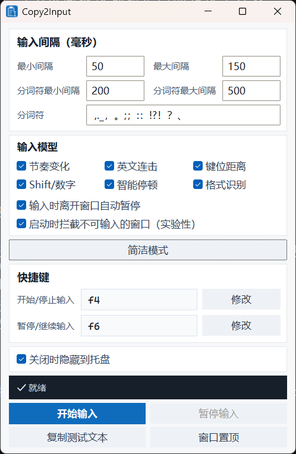

<p align="center">
  
</p>

# Copy2Input

Copy2Input 是一款剪贴板模拟输入工具，支持模拟人类输入习惯、自定义间隔，适配全局快捷键和系统托盘运行。

用于把复制好的文本输入到网页、聊天框、表单、远程窗口，或不方便直接粘贴的输入环境中。

## 功能

- 逐字符模拟键盘输入
- 成对输入引号和括号，先打出两端符号，再把光标移到中间输入内容
- 支持拟人输入间隔和独立的分词符间隔
- 默认显示输入速度滑条，可切换高级模式调整间隔和模型开关
- 可在离开原输入窗口时自动暂停，并拦截明确不可输入的目标
- 支持开始/停止、暂停/继续两组全局快捷键
- 支持关闭窗口后隐藏到系统托盘
- 托盘右上角在输入时显示红灯，暂停时显示黄灯；空闲时剪贴板有足够长度的文本则显示绿灯
- 托盘设置下方提供随窗口宽度调整的三行剪贴板预览
- 配置自动保存
- 支持窗口置顶
- 单实例运行，重复打开时恢复已有窗口
- 窗口按字体和显示缩放自动计算尺寸

## 应用概览

| 1. 简洁模式 | 2. 高级模式 |
| :---: | :---: |
|  |  |

## 使用方法

Copy2Input.exe 是单文件 EXE，点击直接运行。首次运行会生成 `config.json` 存储个人设置。

1. 复制要输入的文本。
2. 运行 Copy2Input。
3. 把光标放到目标输入框。
4. 按 `F4` 开始输入。
5. 再按 `F4` 终止输入，或按 `F6` 暂停/继续。

默认快捷键：

| 操作 | 快捷键 |
| --- | --- |
| 开始/停止 | `F4` |
| 暂停/继续 | `F6` |

如果快捷键冲突，可以点击“修改”，按下新的组合键后自动保存。支持功能键 `F1`–`F24`，以及含 `Ctrl`、`Alt`、`Shift`、`Win` 的组合键。

## 模拟输入

### 成对符号

支持常见中英文双引号、单引号及大括号、中括号和小括号。两端符号之间最多可有 80 个字符，支持嵌套。以 `a(b)c` 为例，程序输入 `a(`，等待一次普通字符的随机间隔后输入 `)`，向左移动光标后输入 `b`，再向右移出括号输入 `c`。未配对的符号按原顺序输入。

### 剪贴板预览

“关闭时隐藏到托盘”下方的三行预览随剪贴板更新。能放下的文本完整显示，超出时用 `...` 分隔开头和结尾，窗口越宽，显示的内容越多。空闲时，去掉首尾空白后的剪贴板文本超过 20 个字符，托盘右上角显示绿灯。

### 输入速度

启动时默认进入简洁模式，上方是“输入速度”滑条，下方是“高级模式”按钮。滑条从左到右由慢变快，范围为 0–100，默认 50；此数值表示速度档位。点击“高级模式”显示四个间隔值、分词符、六个模型开关和两个窗口保护开关，点击“简洁模式”返回，窗口随模式调整尺寸。

拖动滑条会同时调整普通字符和分词符的最小、最大间隔，并调节模型的节奏波动、常见英文组合加速、重复按键及 Shift/数字切换开销、停顿重心。高速度对应更熟练、连贯的节奏，仍保留词句停顿与随机变化。间隔采用连续的指数比例，50 档保持原默认值：

| 速度档位 | 普通字符间隔（ms） | 分词符间隔（ms） |
| --- | --- | --- |
| 0 | 150–450 | 600–1500 |
| 50 | 50–150 | 200–500 |
| 100 | 17–50 | 67–167 |

切换模式不会覆盖手动设置。高级模式手动调整后，简洁模式显示“自定义”；再次拖动滑条才应用对应的速度预设，模型开关和分词符内容会保留。所有调整自动保存。输入期间（包括暂停时），速度滑条、间隔、分词符和模型开关均置灰，仍可切换简洁模式与高级模式；输入完成、停止或出错后恢复编辑。旧配置保留原有间隔和开关，模型速度参数默认使用 50 档。

### 输入间隔

输入间隔由模型统一计算：

| 类型 | 说明 |
| --- | --- |
| 普通字符间隔 | 在间隔范围内模拟连续快慢变化，结合常见英文字母组合、键位距离、数字及 Shift 切换调整节奏 |
| 分词符间隔 | 按词间、分句、句末和换行分级停顿，保持在分词符间隔范围内 |

间隔单位都是毫秒。数值越小，输入越快。

间隔设置直接作为模型的参数，不会在模型延迟之外再追加一次等待；实际输出使用 `keyboard.write(..., delay=0)`。普通字符受最小、最大间隔限制，边界停顿受分词符最小、最大值限制。普通间隔范围过窄（尤其最小值等于最大值）会削弱或消除字符快慢差异；分词符上下限相等会消除不同边界等级的停顿时长差异。分词符间隔若低于普通间隔，词句边界可能反而更快。默认的 50–150 ms / 200–500 ms 可保留这两类变化。开始时释放已按下的修饰键可能有一次性等待，不会逐字符叠加。

模型会将连续标点、闭引号和空白合并为一次边界停顿，避免句号与后续空格重复长停。小数、千位分隔数字、版本号、域名、邮箱、URL、单词内下划线及常见英文缩写中的标点不会触发内部长停。分词符留空时关闭所有边界停顿。最后一个字符输出后立即结束。

### 输入模型

高级模式的“输入模型”提供六个独立开关，默认全部开启，自动保存，并在下一次输入时生效：

| 开关 | 控制内容 |
| --- | --- |
| 节奏变化 | 连续快慢变化与轻微疲劳、恢复 |
| 英文连击 | 常见英文字母组合加速 |
| 键位距离 | 键位移动距离与重复按键开销 |
| Shift/数字 | 大小写、符号切换和数字的节奏调整 |
| 智能停顿 | 合并边界停顿，并按词、分句、句、行和段分级；关闭后按分词符逐个停顿 |
| 格式识别 | 识别小数、版本号、网址、邮箱及常见英文缩写，避免内部标点长停 |

“复制测试文本”提供约 1,000 字符的多段样例，覆盖英文组合、键位跨度、重复字母、大小写与符号、数字、缩写、URL、邮箱、连续标点、换行、段落及中英文 Unicode 混排。

### 窗口保护

高级模式在“输入模型”下方提供两个独立开关，默认开启，自动保存。输入期间（包括暂停时）开关置灰，停止后可修改。

| 开关 | 行为 |
| --- | --- |
| 输入时离开窗口自动暂停 | 开始时记录前台窗口及其进程；离开后保留输入进度并暂停，在状态栏和托盘通知中提示。返回原窗口后按 `F6` 继续，不会自动恢复 |
| 拦截不可输入的窗口 | 开始或继续时检查黑名单，明确不可输入时保持暂停；无法确认的浏览器、终端或自绘控件放行 |

黑名单包括：无前台窗口、Copy2Input 自身、桌面或任务栏、已关闭／隐藏／最小化／禁用的窗口、菜单或窗口移动缩放状态、无输入焦点、禁用控件、标准按钮等非文本控件，以及明确只读的标准 Edit／RichEdit 文本框。检查失败或未知控件不会仅因无法确认可输入性而被拦截。

点击主界面的“开始输入”时，若当前仍是 Copy2Input 窗口，会先暂停。切换到目标输入框后按 `F6`，此时绑定目标并继续原剪贴板内容。失焦暂停后只能回到原窗口继续；若要改换目标，先停止再重新开始。

窗口保护按顶层窗口判断，同一窗口内切换标签页或控件不会触发失焦暂停；黑名单仅在开始和继续时检查。输入过程中每 50 毫秒检查窗口，并在每次发送字符或移动光标前再次检查。全局键盘发送与焦点切换无法做到原子操作，极短的切换间隙仍可能有一次按键进入其他窗口。

## 开发

以下内容主要面向开发者。

### 目录说明

| 位置 | 用途 |
| --- | --- |
| `main.py` | 源码入口 |
| `typing_model.py` | 英文输入节奏与边界识别 |
| `window_guard.py` | Windows 前台窗口识别与保守的不可输入状态黑名单 |
| `assets/` | 程序 ICO、窗口 PNG 与托盘状态图标 |
| `hooks/hook-PIL.Image.py` | 托盘所需的 Pillow 图像插件 |
| `tests/test_app.py` | 界面布局、自动保存、快捷键、输入状态与打包依赖的自动测试 |
| `tools/generate_icons.py` | 原创图标生成脚本，使用 Pillow，可重新生成图标资源 |
| `release/Copy2Input.exe` | 单文件程序，日常运行使用此处 |
| `requirements.txt` | Python 依赖 |
| `Copy2Input.spec` | 当前打包配置 |

### 从源码运行

以下命令均在项目根目录执行。

```bash
python -m pip install -r requirements.txt
python main.py
```

依赖：

- `keyboard`
- `pyperclip`
- `pystray`
- `Pillow`

### 打包

默认使用 `Copy2Input.spec`，采用 PyInstaller `onefile` 打包，生成单文件程序 `release/Copy2Input.exe`。

```bash
python -m pip install -r requirements.txt
python -m PyInstaller --clean --noconfirm --distpath release --workpath tmp/build Copy2Input.spec
```

### 测试

```bash
python -B -m unittest discover -s tests -p test_app.py -v
```

### 配置文件

设置在修改后自动保存，无需手动编辑配置文件。输入框编辑有防抖，不会保存暂时无效的数字。EXE 运行时，`config.json` 位于 EXE 所在文件夹；从源码运行时，位于 `main.py` 所在文件夹。

默认配置：

```json
{
  "min_speed": 50,
  "max_speed": 150,
  "hotkey": "f4",
  "pause_hotkey": "f6",
  "separator_min_delay": 200,
  "separator_max_delay": 500,
  "separators": " ,._，。;；:：!?！？、",
  "model_tempo": true,
  "model_bigrams": true,
  "model_key_distance": true,
  "model_shift_digits": true,
  "model_smart_pauses": true,
  "model_english_tokens": true,
  "pause_on_focus_loss": true,
  "block_untypable_windows": true,
  "hide_to_tray": true,
  "always_on_top": false
}
```

| 字段 | 说明 |
| --- | --- |
| `min_speed` | 普通字符的最小间隔 |
| `max_speed` | 普通字符的最大间隔 |
| `hotkey` | 开始/停止快捷键 |
| `pause_hotkey` | 暂停/继续快捷键 |
| `separator_min_delay` | 分词符随机间隔的最小值，单位为毫秒 |
| `separator_max_delay` | 分词符随机间隔的最大值，单位为毫秒 |
| `separators` | 分词符字符集合，默认包含空格、逗号、句点、下划线等 |
| `pause_on_focus_loss` | 离开原输入窗口时自动暂停 |
| `block_untypable_windows` | 开始或继续时拦截明确不可输入的窗口 |
| `hide_to_tray` | 关闭窗口时是否隐藏到托盘 |
| `always_on_top` | 是否保持窗口置顶 |

## Credits

本项目的拟人化输入算法参考了以下项目：

- [luishacm/human-keyboard](https://github.com/luishacm/human-keyboard)
- [UnMars/human_typer](https://github.com/UnMars/human_typer)

## License

本项目采用 [MIT License](LICENSE)。第三方依赖保留各自的权利和许可条款。
